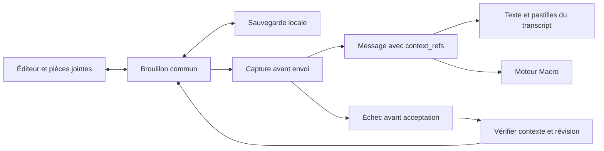

# Contrat du composeur

Le composeur présente deux niveaux : pièces jointes et texte contenant des références. Les skills, fichiers, sources et sélections AgSDL suivent le même cycle de vie.

## Données et responsabilités

- `ComposerDraft` regroupe le texte, les images et les références. Sa sauvegarde est isolée par conversation ou contexte provisoire.
- `MentionNode` affiche toutes les références, y compris AgSDL. Il conserve leur identité et les données nécessaires à leur restauration par l'historique.
- `composerReferenceText.ts` définit leur représentation textuelle avec identifiant stable. Les anciens marqueurs restent lisibles. Les titres ne servent plus à retrouver les nouvelles références.
- `composerSubmission.ts` capture les données avant les opérations asynchrones, compare les brouillons et sérialise les références vers `context_refs`. Il produit également le contexte destiné au moteur à partir des références persistées.
- `composerTransaction.ts` possède la capture, l'acceptation et les règles de nettoyage/restauration d'un envoi. Le contexte et la révision empêchent une opération différée de modifier un autre brouillon.
- `ChatZone` relie cette transaction aux états de présentation, à la sauvegarde et au moteur existant.
- `useChatStore` persiste le message et exécute le tour. La publication du message constitue son acceptation ; elle ne dépend pas de la fin du travail de l'agent.

## Règles d'envoi

Le texte, les images et les références sont copiés avant la préparation. L'envoi normal, le démarrage d'une tâche et les messages pendant un tour actif transmettent leurs références explicitement. La file d'attente conserve sa propre copie.

Le nettoyage ne doit pas modifier un brouillon qui a changé depuis la capture. L'échec d'un envoi normal peut restaurer le brouillon seulement si sa révision et son contexte sont encore compatibles. Une erreur survenue après publication du message ne remet pas ce message dans le composeur.

La fin d'une opération ne complète jamais son contexte à partir de la sélection actuelle de l'utilisateur. Les appels internes plus anciens du store qui ne fournissent pas de références conservent une capture à l'entrée de l'appel pour compatibilité.

## Édition, historique et compatibilité

L'édition restaure les références du message avec son texte et ses images. Le replay reçoit explicitement les références modifiées et le contexte associé. Tauri les écrit dans la même transaction que le message et conserve les valeurs précédentes dans son mécanisme de récupération.

L'historique Lexical conserve les métadonnées des références. Annuler une suppression restaure aussi ces données. L'historique est réinitialisé au changement de contexte d'édition et au nettoyage après envoi.

Les anciens messages AgSDL peuvent n'avoir qu'une enveloppe dans `hidden_context`. Un lecteur de compatibilité permet leur affichage et reconstruit une référence lors de leur édition. Les nouveaux messages utilisent `context_refs` ; l'enveloppe reste le format du contexte transmis au modèle.

Les brouillons existants restent compatibles avec le stockage actuel. Une référence AgSDL y conserve notamment son plan, sa branche et sa révision. Une sélection devenue obsolète bloque l'envoi et reste retirable.

## Vérifications utiles

Les tests portent sur les identités homonymes, la copie de la capture, la persistance AgSDL, l'échec après une nouvelle saisie, l'acceptation suivie d'une erreur, le nettoyage différé d'une instruction, l'édition et l'annulation avec le vrai historique. Les tests du repository Tauri couvrent l'écriture des références pendant le replay et la restauration de la transaction.

## Copier-coller et références indisponibles

`useComposerClipboard` gère la copie, la coupe et le collage. À l'intérieur de Macro, le format Lexical transporte le nœud et ses métadonnées. Vers une application externe, le texte et le HTML contiennent uniquement le titre lisible. Un collage provenant d'une autre application reste du texte.

Supprimer une occurrence ne retire pas le contexte tant qu'une autre occurrence de la même référence reste dans le composeur. Le collage et l'annulation restaurent les métadonnées dans le store commun.

`resolveReference` est partagé par le composeur et le transcript. Une nouvelle référence est résolue exclusivement par son identité et son type. Une identité introuvable ou malformée devient du texte, jamais une référence homonyme. La résolution par titre est réservée aux anciens marqueurs et exige une correspondance unique. Leur ancien rendu sans métadonnées reste pris en charge pour la compatibilité.

Le collage AgSDL entre conversations ne contourne pas la vérification du plan, de la conversation et de la révision à l'envoi. Une sélection incompatible doit être retirée ou sélectionnée à nouveau dans le graphe de destination.

Le brouillon accepte au plus une sélection AgSDL à l’envoi. Si un collage ou une restauration en introduit plusieurs, elles restent visibles et l’envoi est bloqué jusqu’au retrait des sélections en trop. Le contrôle s’applique aussi aux instructions pendant un tour actif et aux appels directs du store. Une sélection envoyée se rend à son emplacement dans le texte ; la pastille séparée reste réservée aux messages qui n’ont pas de marqueur intégré.
